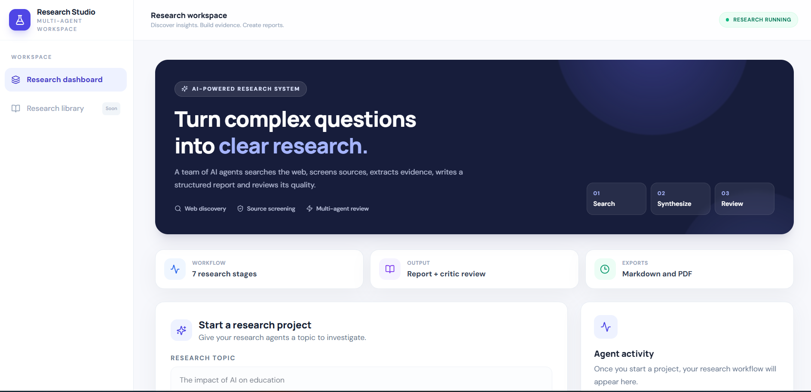
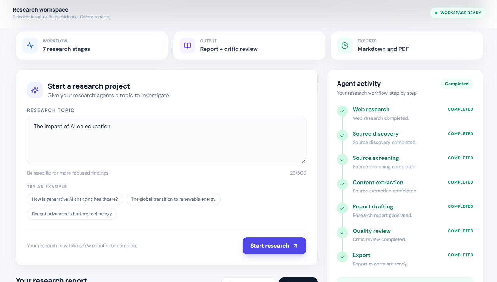
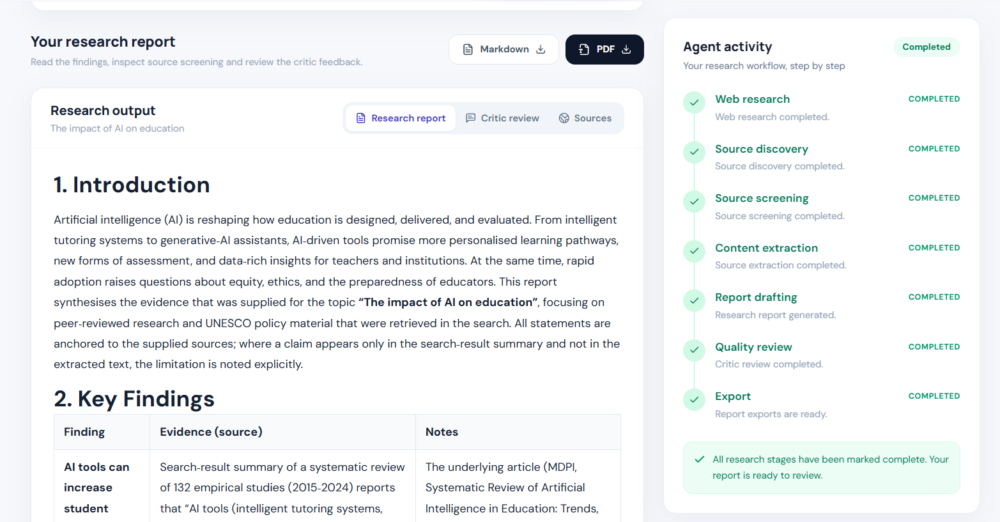
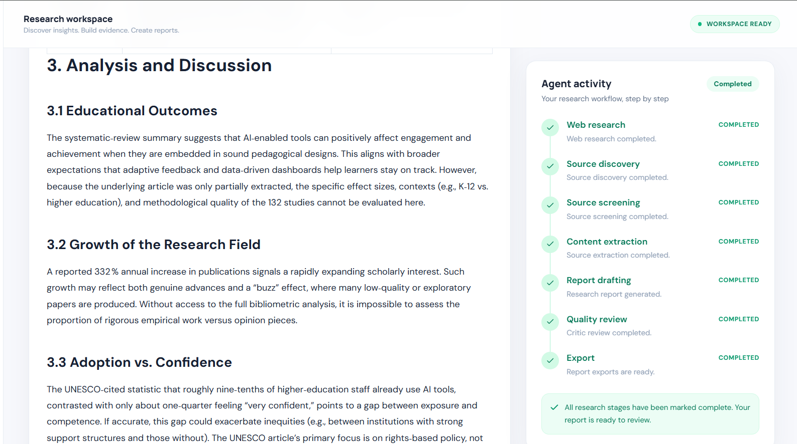
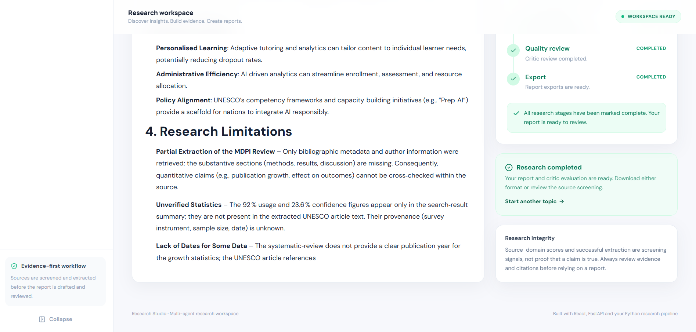

# Research Studio — Multi-Agent AI Research Workspace

A modern React and Tailwind CSS dashboard for a Python-based multi-agent research pipeline. Research Studio searches the web, screens sources, extracts evidence, drafts a structured report, reviews report quality, and provides Markdown and PDF exports.

## 🚀 Live Application

**[Open Research Studio](https://ai-research-agent-mu-roan.vercel.app)**

## 📸 Application Screenshots

### 1. Research Studio Dashboard


### 2. Research Workspace and Agent Activity


### 3. Generated Research Report


### 4. Analysis and Discussion


### 5. Research Limitations and Completion Status


## ✨ Features

- AI-powered web research
- Multi-agent research workflow
- Web search and source discovery
- Source screening and content extraction
- Structured AI-generated research reports
- Critic agent for report quality evaluation
- Markdown and PDF report exports
- Live workflow progress updates
- React dashboard connected to a FastAPI backend

## 🧰 Technology Stack

**Frontend**
- React
- Vite
- Tailwind CSS

**Backend**
- Python
- FastAPI
- LangChain
- Groq
- Tavily

**Research and extraction**
- BeautifulSoup
- Trafilatura
- Playwright (optional scraper fallback)

## 📁 Project Structure

```text
Ai-Research-Agent/
├── backend/
│   ├── main.py
│   ├── agents.py
│   ├── pipeline.py
│   ├── tools.py
│   ├── research_quality.py
│   ├── report_export.py
│   ├── requirements.txt
│   └── .env.example
├── frontend/
│   ├── src/
│   ├── package.json
│   └── .env.example
├── screenshots/
│   ├── dashboard.png
│   ├── research-workspace.png
│   ├── research-report.png
│   ├── analysis-and-discussion.png
│   └── research-limitations.png
├── .gitignore
└── README.md
```

## ⚙️ Run Locally

### 1. Clone the repository

```bash
git clone https://github.com/SAYANBAG018/Ai-Research-Agent.git
cd Ai-Research-Agent
```

### 2. Configure the backend

Use Python 3.10 or newer. From the backend directory:

**Windows PowerShell**
```powershell
cd backend
python -m venv .venv
.venv\Scripts\Activate.ps1
python -m pip install --upgrade pip
pip install -r requirements.txt
Copy-Item .env.example .env
```

**macOS / Linux**
```bash
cd backend
python -m venv .venv
source .venv/bin/activate
python -m pip install --upgrade pip
pip install -r requirements.txt
cp .env.example .env
```

Add your own `GROQ_API_KEY` and `TAVILY_API_KEY` values to `backend/.env`. Never commit this file or expose API keys publicly.

If you want to use the optional Playwright scraper fallback, install Chromium:

```bash
python -m playwright install chromium
```

### 3. Start the backend

Run from the `backend` directory:

```bash
uvicorn main:app --reload --host 0.0.0.0 --port 8000
```

### 4. Configure and start the frontend

Open a second terminal:

```bash
cd frontend
npm install
```

Copy `frontend/.env.example` to `frontend/.env` and configure `VITE_API_URL` for your local backend if needed. Then run:

```bash
npm run dev
```

Open the local Vite URL shown in your terminal (normally `http://localhost:5173`).

## 🔌 API Overview

- `GET /api/health` — backend health check
- `POST /api/research` — starts a research job
- `GET /api/jobs/{job_id}` — retrieves job status and report metadata
- `GET /api/jobs/{job_id}/events` — streams workflow progress using Server-Sent Events (SSE)
- `GET /api/jobs/{job_id}/download/markdown` — downloads the Markdown report
- `GET /api/jobs/{job_id}/download/pdf` — downloads the PDF report

## 🛡️ Security and Deployment Notes

- Keep `.env` files and API keys out of GitHub. Use the hosting providers' environment-variable settings for deployed secrets and configuration.
- Set the frontend `VITE_API_URL` to the deployed backend origin in the frontend hosting environment.
- Configure backend CORS to allow the deployed frontend origin.
- The current backend keeps job state in process memory; restarting the service clears job history.
- Add authentication, rate limiting, and durable background-job storage before using the application for sensitive or high-volume workloads.
- Source screening and successful extraction are not proof that a claim is true. Review source evidence and citations before relying on a generated report.

## 🏗️ Build the Frontend

```bash
cd frontend
npm run build
```

The production build is generated in `frontend/dist`.
